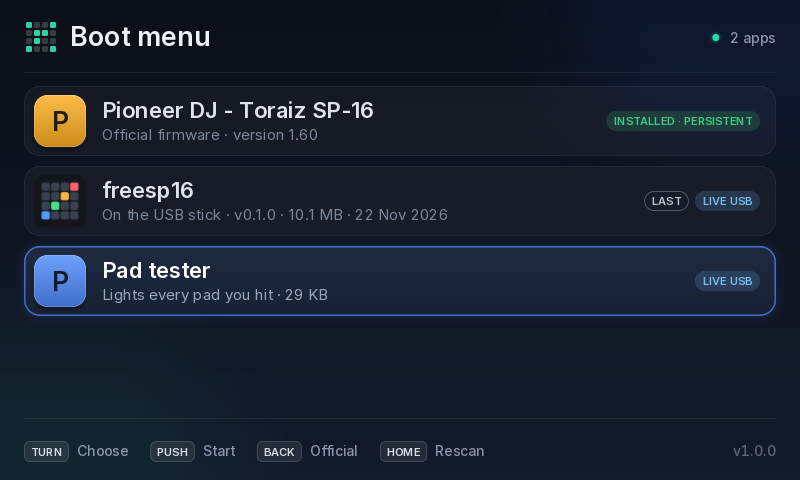

# Boot menu

A community boot menu for the Pioneer DJ TORAIZ SP-16. Put it on a USB stick, plug the stick in, and choose what
the unit runs: its official software, or community software from the stick.



- **Runs from the stick only.** Nothing is installed and nothing is written to the unit's internal memory. Pull the
  stick and the official software comes back.
- **Launches community software.** Any compatible program copied next to `autoexec.bin` shows up in the list.
  Updating it means copying a new file.
- **Built for the hardware.** It starts while the official software is still shutting down and draws on the GPU,
  so the menu is on screen quickly and reacts immediately to the SELECT encoder.
- **Remembers your choice.** The last app you started becomes the default and starts on its own after a short
  countdown.

## Install

1. Download `autoexec.bin` from the [latest release](../../releases/latest).
2. Copy it to the root of a FAT32 USB stick, together with the software you want to run.
3. Plug the stick into the SP-16 while it is on.

| Control | Action |
|---|---|
| Turn **SELECT** | choose |
| Push **SELECT** or **PLAY** | start |
| **BACK** | go to the official software (twice: start it) |
| **HOME** | look for apps on the stick again |
| Touch a row | start it |

Settings (default app, countdown) go in an optional `bootmenu.conf` on the stick: see [docs/usage.md](docs/usage.md).

## Community software

The menu lists every program built for the unit (32-bit ARM, armel, glibc 2.13) that it finds in the stick's root
folder or in `apps/`. Programs can show their own name, version and icon. [docs/apps.md](docs/apps.md) explains how
to make your software appear.

## Building

```bash
tools/build.sh                                 # out/bootmenu (needs Docker)
BOOTMENU_AES_KEY=... tools/build-image.py      # out/autoexec.bin
```

The unit only accepts an image encrypted with its device key, which is **not** part of this repository. Releases
are built by CI with the key stored as a secret. See [docs/development.md](docs/development.md) for tests, CI and
releases.

## License

GPL-3.0-or-later (see [LICENSE](LICENSE)). The Inter font is under the SIL Open Font License
([fonts/INTER-LICENSE.txt](fonts/INTER-LICENSE.txt)).

This is an independent community project. It is not affiliated with or endorsed by Pioneer DJ or AlphaTheta.
TORAIZ and SP-16 are their trademarks, used here only to say which hardware this runs on. No firmware is included.
